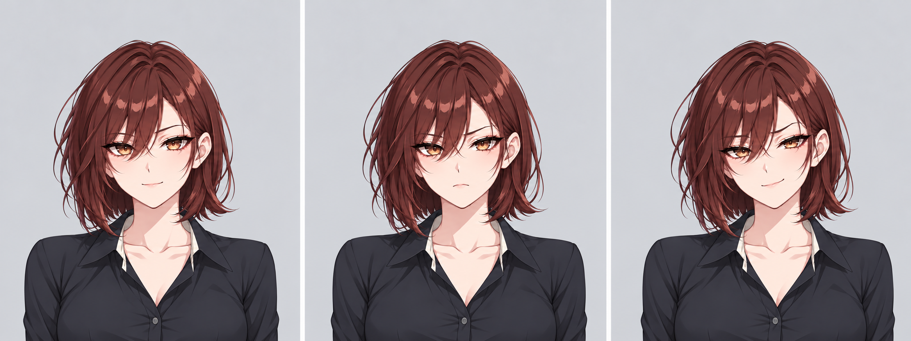
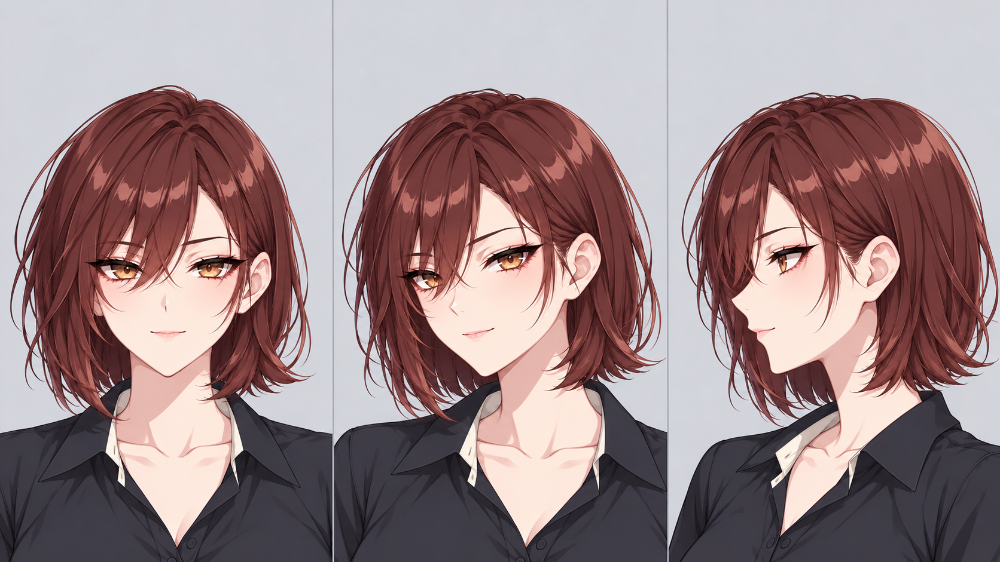

# AI-art-P · 윤서린 캐릭터 제작

## 최신 다운로드

- [최신 얼굴·표정·방향 검토본 ZIP](https://github.com/butterpopc/AI-art-P/releases/download/artwork-review-v4/face-review-v4.zip)
- [생성 이미지 전체 ZIP · 26장](https://github.com/butterpopc/AI-art-P/releases/download/artwork-review-v4/generated-artwork-library.zip)
- [전체 PNG 파일 목록](artwork/)
- [최신 제작 검수](reviews/face-progress-v4.md)

현재 후보는 적갈색 단발·호박색 눈의 새 외형입니다. 아래 윤서린 v2 내용은 이전 작업 기록입니다. 모든 후보는 클라이언트 승인 전입니다. 사용자 제공 참고 원본과 인증정보는 공개하지 않습니다.

> 최신 상태: 기존 결과는 클라이언트 반려로 보류했습니다. 원본 참고 다섯 장을 수신해 [차이 분석과 수정 기준](reviews/reference-reset.md)을 기록했습니다. 아래 v2 패키지는 이전 작업 기록이며 현재 전달 추천본이 아닙니다.

현대 배경 게임의 성인 여성 메인 히로인을 설계하는 프로젝트입니다. 현재는 **수정본을 반영한 클라이언트 검토 패키지 v2**이며, 외형과 작화에 대한 최종 승인은 아직 받지 않았습니다.

## 결과물 보기

[`index.html`](index.html)을 브라우저에서 열면 선정 이미지 네 장과 평가 양식을 볼 수 있습니다. 인터넷 연결이나 별도 설치는 필요하지 않습니다. 평가 내용은 화면의 **평가 파일 저장**으로 내려받아 전달할 수 있으며, 자동 전송되지 않습니다.

| 결과물 | 용도 | 원본 |
|---|---|---|
| 대표 이미지 | 첫인상·얼굴·체형·의상 평가 | [PNG](artwork/seorin-key-visual-v1.png) |
| 4방향 전신 설정화 v2 | 정면·측면·후면·¾ 방향의 연결 검토 | [PNG](artwork/seorin-turnaround-v2.png) |
| 6종 표정 시트 v2 | 미소·웃음·집중·장난·수줍음·불만 | [PNG](artwork/seorin-expressions-v2.png) |
| 이브닝 의상안 | 성숙한 매력과 이벤트 의상 방향 비교 | [PNG](artwork/seorin-evening-v1.png) |

위 네 이미지는 현재 환경의 `image_gen` 도구로 제작했습니다. **NovelAI 결과물은 아닙니다.** NovelAI는 Opus 인증과 첫 이미지 생성까지 확인했으며, 해당 결과는 별도로 검수·선정합니다. 실제 도구와 결과는 [NovelAI 작업 안내](docs/novelai.md) 및 이미지별 제작 기록에서 구분합니다.

## 작업 기준

- [제작 계획](docs/production-plan.md): GPT 구조 설계와 V5 Full 작화 탐색의 역할, 최소 비교와 중단 기준입니다.
- [V5 자료 조사](docs/v5-research.md): 공식 문서·커뮤니티 접근 상태·작가 태그 후보와 검증 한계입니다.
- [파이프라인 시험 평가](reviews/pipeline-evaluation.md): V4.5 시험 두 장을 최종 전달에서 제외한 이유와 확인된 Anlas 차감입니다.
- [요구사항과 결정 이력](docs/brief.md): 사용자 요구, 제작자 판단, 미확정 사항을 구분합니다.
- [작화·외형 가이드](docs/art-direction.md): 재현할 특징과 방향별 연결 기준입니다.
- [현재 선정본 검수](reviews/v2.md): 개선한 부분과 남은 한계입니다.
- [초기 검수 기록](reviews/v1.md): 교체 전 v1 이미지의 검수 이력입니다.
- `prompts/`: 각 이미지에 실제 사용한 생성 지시문입니다.

사용자는 결과물을 클라이언트에게 전달하고 취향을 확인합니다. 도구 선택, 이미지 제작, 비교, 수정, 기록은 제작자가 수행합니다. 새 결제는 하지 않으며 기존 계정의 제공 범위와 무료 도구를 우선합니다. 기존 Anlas의 제한적 사용은 허용되었으며, 각 실행의 사용량을 별도로 확인합니다.

## 현재 범위

윤서린이라는 이름, 27세, 머리·눈·의상·배색은 제작자가 정한 제안입니다. 프로젝트의 확정 요구는 현대 배경, 성인 여성 인간형, 메인 히로인, 여러 방향에서 이어지는 설정화입니다. 현재 이미지는 외형 검토용이며, 3D 모델·리깅·게임 엔진에 바로 넣을 분리 레이어 자산은 포함하지 않습니다.

실제 클라이언트 피드백이 오면 `reviews/`에 원문과 반영 결과를 기록하고, 기존 이미지를 보존한 채 다음 버전을 추가합니다.

V5 Full 여섯 장의 통제 비교를 완료했습니다. 얼굴 표현 변화는 확인했으나 구조 일관성이 부족해 선정본은 유지합니다. [비교 페이지](comparison-v5.html)와 [검수 기록](reviews/v5-comparison.md)에서 결과·설정·비용을 확인할 수 있습니다. 이번 추가 차감은 0 Anlas입니다.
